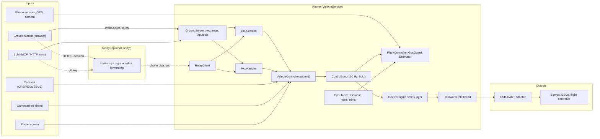
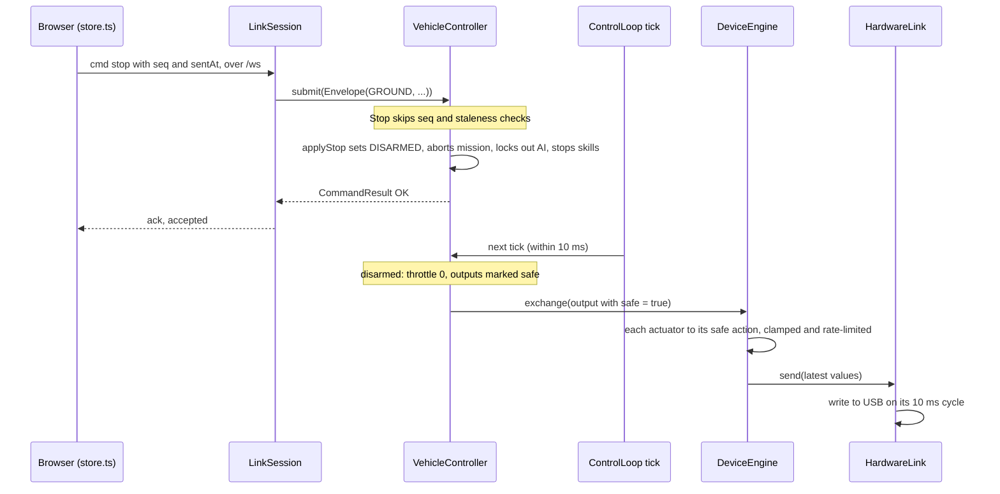

# Architecture

How SmartPhoneX fits together, for people about to change it. Wire formats and rules live in [SPEC.md](SPEC.md),
security in [THREAT_MODEL.md](THREAT_MODEL.md), wiring in [USB_HARDWARE.md](USB_HARDWARE.md) and the plan format in
[PLANNING.md](PLANNING.md). This page links to them instead of repeating them.

## Overview

SmartPhoneX is an Android app that makes the phone the vehicle computer of a rover, boat, plane, arm or walker. All
authority sits on the phone: one `VehicleController` decides what every command source may do, a 100 Hz control loop
mixes the result into outputs, and a safety layer clamps those before anything reaches USB-UART hardware. Everything
else only asks. The browser ground station (Preact, `web/src`) is built into the app's assets and served by the phone
itself over a WebSocket. LLMs reach the same command path through MCP or plain HTTP tools. For use over mobile data,
the phone dials out to an optional Node relay (`relay/`) that signs people in and forwards traffic, but holds no
vehicle logic. The vehicle logic is plain Kotlin in `core/` with no Android imports, so it runs in JVM unit tests.
The Android layer in `app/` supplies sensors, camera, USB, networking and the phone's own screens.

## Runtime

Dashed lines are the relay path. Only device profiles (an adapter of `device`, run by `DeviceEngine`) write to real
hardware, and only once a person has signed off commissioning. The built-in presets (car, boat, plane and so on) use
`OutputPreview`: the loop computes pulse widths and CRSF or iBus frames and shows them, but nothing is sent. The
simulated car and simulated plane are adapters too. See [USB_HARDWARE.md](USB_HARDWARE.md); the USB-UART path is
listed in [SPEC.md](SPEC.md#untested-with-real-hardware) as untested with real hardware.

## The control loop

### Who can command

Every input becomes an `Envelope(source, seq, sentAt, command)` and goes through `VehicleController.submit()`. Sources
(`Model.kt`) are `LOCAL` (phone screen), `GROUND` (ground station), `AI` (MCP, HTTP tools and the built-in assistant),
`RC` (receiver, via `ReceiverBridge` in `Setup.kt`), `GAMEPAD` (a gamepad on the phone) and `BEHAVIOR` (on-phone
behavior trees and triggers).

Priority follows [SPEC.md, control priority](SPEC.md#control-priority):

1. Any stop, always, from anyone.
2. Receiver, once its sticks move.
3. Gamepad on the phone.
4. Phone screen.
5. Ground station.
6. On-phone behaviors and AI, in AUTO only.

Items 2 to 5 are enforced by `InputRouter` (`Protocols.kt`): a source that moved its sticks holds control for 1.5 s,
and a lower one is answered `not_owner` meanwhile. The AI can't use the manual `drive` path at all; it sends leased
commands (`SetThrottle`, `SetSteering`, `SetSpeed`) that expire after at most `maxAiLeaseMs`, and only in AUTO.

### Where things are enforced

| What | Where |
|---|---|
| Stop and kill | `VehicleController.evaluate`: handled before any other check, so a late or repeated stop is still honoured. Stop disarms, aborts missions, stops skills and behaviors, and latches the AI out until a person re-arms. Kill can't come from AI or behaviors |
| Duplicate and stale commands | `evaluate`: `seq` must increase per source, and `sentAt` must be within `staleCommandMs` (default 1000 ms) |
| Profile limits | `drive` and the AI axis commands reject values past `maxThrottle`, `maxSteering`, `maxSpeedMps`; `tick()` clamps again |
| What the AI may not do | `setMode`, `updateProfile`, `selectProfile`, `setChannels`: no MANUAL, no limit changes, no re-arm after a human stop or failsafe, no arming unless the profile has `aiMayArm`. See [THREAT_MODEL.md](THREAT_MODEL.md) |
| Arming checks | `FlightController.armProblem`, `Ops.armProblem` (readiness), and the device layer's fit check |
| Link loss | `tick()`: MANUAL with no human command for `commandTimeoutMs` (default 500 ms) goes to failsafe, or to return home when the flight controller can do that |
| Automatic failsafes | `FlightController.requestFailsafe` (gyro stopped, GPS lost, fence with action `stop`) is picked up by `tick()`. A flying plane is kept flying (home or circling) rather than having its motor cut |
| Fence, mission link-loss rule, contingencies | `Ops.tick`, run after every control step; fence breaches force HOLD, RETURN_HOME or failsafe |
| GPS trust | `GpsGuard`: navigation only moves on a GOOD estimate. See [NAVIGATION_SAFETY.md](NAVIGATION_SAFETY.md) |
| Obstacle hold | `tick()`: in AUTO, brakes if the range sensor is inside the stop distance |
| Actuator limits | `DeviceEngine.exchange`: every value is clamped to the actuator's min and max and rate-limited, whoever asked. Disarmed or failsafe outputs go to each actuator's safe action (neutral, hold, limp or a value) |
| Hardware gate | `DeviceEngine.exchange`: bytes go to `HardwareLink` only after commissioning sign-off, or for a single slow commissioning move |

### Timing

- `ControlLoop` (`VehicleRuntime.kt`) runs `controller.tick(dt)` at 100 Hz on its own max-priority thread, using real
  elapsed time as `dt`. `Realtime.enter` lets the Android layer (`Priority.kt`) raise priority and use a performance
  hint session. Loop stats (rate, average and worst step, overruns) go out in telemetry.
- Each tick: check link timeout and failsafe requests, pick the axes for the mode, run the flight controller
  (`FlightController.process`, which also runs while disarmed to show what it would command), mix (`Mixer`), apply
  trims and overrides, and call `adapter.exchange()`. Then `Ops.tick` and the flight log row.
- `HardwareLink` writes to USB on its own thread every 10 ms, always the latest values, so a slow adapter never holds
  up the loop. Sensors, behaviors (20 Hz), flight log writes and the camera all run on separate threads.
- The ground station sends `drive` every 50 ms from a Web Worker (`ticker.ts`), so background-tab timer throttling
  doesn't trip the 500 ms link timeout. The phone sends telemetry at 10 Hz, flight state at `TLM_HZ` (default 20) and
  `ops` at 2 Hz (`LinkSession.kt`).

### A STOP from the browser

Through the relay the same message is wrapped in a channel envelope (`{"ch","op":"msg","data"}`) and handed to a
`LinkSession` by `RelayClient`; a viewer may send only `ping` and `stop`. A `drive` command takes the same path, but is
subject to the seq, staleness, limit and ownership checks, and only sets the manual axes that the next tick reads.

## Module map

### `app/src/main/java/com/smartphonex/core/` (pure Kotlin)

| File | Responsibility |
|---|---|
| `Model.kt` | Modes, sources, commands, envelopes, results, `VehicleAdapter` (the hardware boundary) and `VehicleProfile` |
| `VehicleController.kt` | The local authority: validates every command, owns modes, latches and failsafes; `tick()` is the only thing that drives the adapter |
| `VehicleRuntime.kt` | Wires everything together (stores, controller, flight controller, device engine, ops, sensors, token); `ControlLoop` and fault injection |
| `FlightController.kt` | Autopilot: stabilize, hold heading, return home, AUTO and HOLD; arming checks, failsafe requests, flight log |
| `Estimator.kt` | Attitude estimation (complementary filter) and phone-to-vehicle frame rotations |
| `GpsGuard.kt` | Smooths GPS, rejects jumps, reports uncertainty and health so navigation only acts on trusted positions |
| `Ops.kt` | Operating layer: readiness, output tests, trims, triggers, fences, mission engine, plans on disk, reports, contingencies |
| `Plan.kt` | Plan compiler: turns a plan file into the real path, timeline, problems and warnings |
| `PlanTools.kt` | AI planning tools: read, check and propose plans, real coordinates; never send or start one |
| `PlanLearning.kt` | Measures climb, leg times and glide in flight and suggests more realistic planning settings for a person to approve |
| `QgcPlan.kt` | QGroundControl `.plan` import and export |
| `Advisories.kt` | Advisory airspace and no-go layers (built-in India airport bands, imported zones); inform, never block |
| `GroundTest.kt` | Evidence the vehicle behaves before it's trusted: self-test, link, outputs, stop, route, fence |
| `GroundRun.kt` | Experimental restrained motor run, measured by microphone, as a reference for airspeed estimates |
| `PropSensor.kt` | Experimental propeller tone analysis from the microphone, in memory only |
| `Device.kt` | Device description schema (actuators, transports, inputs, skills, behaviors, commissioning) and `DeviceStore` |
| `DeviceEngine.kt` | Runs a described device as a `VehicleAdapter`: the actuator safety layer, `HardwareLink`, gaits, behavior trees |
| `Setup.kt` | Guided, LLM-driven setup with person-only approvals; `ReceiverBridge` connects a receiver to the command path |
| `Protocols.kt` | Transports, actuator protocol drivers (pulse frames, LX-16A, Feetech, Dynamixel, text), receiver parsers, `InputRouter`, MAVLink frames |
| `Vehicles.kt` | Channels, `Mixer`, CRSF and iBus frames, `OutputPreview` and the built-in vehicle presets |
| `Params.kt` | Named, bounded flight controller settings per vehicle |
| `ProfileStore.kt` | Vehicle profiles saved as JSON |
| `Sensors.kt` | `SensorHub`: latest reading of each sensor, rates, priorities and the data budget; `CameraAccess` interface |
| `Codec.kt` | Wire format shared by the WebSocket link and MCP: parse commands and envelopes, encode telemetry and logs |
| `McpHandler.kt` | MCP over stateless JSON-RPC, and the same tools for `/api/tools`; every call is an `AI` command |
| `Pairing.kt` | Swaps a 6-digit code shown on the phone for the access token, with growing lockouts |
| `EventLog.kt` | Bounded in-memory event and command logs |
| `AppData.kt` | Data versioning, migrations, backup and staged restore |
| `TileCache.kt` | Map tiles kept on the phone for offline use |
| `Face.kt` | Decides what the on-screen face shows; safety states win |
| `Probe.kt` | ICMP packet loss measurement |
| `SimulatedCar.kt` | Kinematic car simulator adapter |
| `SimulatedPlane.kt` | Fixed-wing simulator flown by the real flight controller |
| `Versions.kt` | Version comparison and release feed parsing |

### `app/src/main/java/com/smartphonex/app/` (Android)

| File | Responsibility |
|---|---|
| `VehicleService.kt` | Foreground service that owns the runtime: wake and Wi-Fi locks, thermal handling, starts everything below |
| `MainActivity.kt` | The phone's own app: permissions, links, dialogs and the gamepad (`GAMEPAD` source) |
| `AppUi.kt` | Compose screens on the phone (`LOCAL` source), rebuilt 10 times a second |
| `FaceScreen.kt` | Draws the face |
| `GroundServer.kt` | Ktor server on port 8080: web assets, `/ws`, `/video`, `/mcp`, `/api/tools`, pairing, backup, diagnostics, review files, tiles |
| `LinkSession.kt` | One ground station conversation, local or through the relay: sends hello, telemetry, flight state, ops and sensors; handles incoming messages |
| `RelayClient.kt` | The phone's outgoing connection to the relay: channels, MCP and HTTP tool calls, video |
| `CameraStreamer.kt` | Camera2 JPEG stream to viewers, only while someone watches; frames are skipped rather than queued |
| `VideoRecorder.kt` | Saves about two frames a second beside the flight log for review |
| `AndroidSensors.kt` | Discovers the phone's sensors and GPS and feeds `SensorHub` and the flight controller |
| `AndroidIo.kt` | USB-UART transports (usb-serial-for-android) and the read-only MAVLink telemetry bridge |
| `PropListener.kt` | Microphone listener for the experimental propeller sensor |
| `Assistant.kt` | Built-in chat assistant on the phone (Anthropic or OpenAI-compatible), using the same tools; key kept in the Keystore |
| `NetMonitor.kt` | Network type, signal and data use |
| `Priority.kt` | Thread priority and performance hint sessions for time-critical threads |
| `Diagnostics.kt` | Exit reasons, crashes and the phone report, kept on the phone |
| `Updates.kt` | Tells people a newer release exists; never downloads |

### `web/src/` (ground station)

Built with Vite into `app/src/main/assets/web` (`web/vite.config.ts`). The built files are committed.

| File | Responsibility |
|---|---|
| `main.tsx` | Entry, pairing screen, status bar, STOP and page switching |
| `store.ts` | Connection and state: token or relay session, WebSocket protocol handling, commands with `seq` and acks, stick and keyboard input, gamepad, alerts |
| `ticker.ts` | Web Worker beat (50 ms) for manual control |
| `operate.tsx` | Operate page: drive the vehicle, map, video, telemetry |
| `plan.tsx` | Plan page: plan files on a map, checked live by the phone; pose timelines for jointed devices |
| `plan3d.ts` | 3D plan view, loaded on demand |
| `map.ts` | Small canvas tile map |
| `test.tsx` | Test page: ground test, output tests and reports run by the phone |
| `setup.tsx` | Setup page: device, assistant, trim, triggers, settings, sensors, camera |
| `review.tsx` | Review page: logs, track, video and events on one timeline |
| `parts.tsx` | Shared components |
| `style.css` | Styles |

### `relay/`

| File | Responsibility |
|---|---|
| `server.mjs` | HTTP and WebSocket server: sign-in, sessions, roles, phone enrollment by QR, forwarding browser channels, MCP and HTTP tools, and video to the phone; per-connection message limits, sign-in lockouts and an audit log |
| `auth.mjs` | `AuthStore`: users (scrypt), AI keys and the vehicle key, stored as hashes only |
| `admin.mjs` | CLI to add or remove users and AI keys and replace the vehicle key |
| `test/relay.test.mjs` | Security and forwarding tests against a stand-in vehicle |
| `Dockerfile` | Container image; `deploy/` has a Caddy and Docker Compose setup |

### `tools/`

| Purpose | Scripts |
|---|---|
| Live acceptance tests on a phone or emulator | `e2e.mjs`, `device-e2e.mjs`, `any-device-e2e.mjs`, `fc-e2e.mjs`, `backup-e2e.mjs`, `face-e2e.mjs`, `diag-e2e.mjs`, `sim-flight.mjs` |
| Relay path | `relay-e2e.mjs`, `remote-lib.mjs`, `enroll.mjs`, `qr-e2e.sh`, `agent-run.mjs`, `measure.mjs` |
| Ground station in a real browser | `gs-check.mjs` (against a phone), `browser-check.mjs` (through a relay), `preview-station.mjs` (sample data, no phone), `size-budget.mjs` |
| Performance and link quality | `soak.mjs`, `stress.mjs`, `link-probe.mjs`, `stall-test.mjs`, `lag-proxy.mjs`, `gaps.py`, `screenoff.sh` |
| Experimental propeller sensor | `ground-run.mjs`, `prop-e2e.mjs`, `prop-sweep.mjs`, `prop-sweep.py` |
| Stand-ins and observers | `fake-llm.mjs`, `watch-phone.mjs` |
| Integrations | `ros2_bridge.py` (read-only ROS 2 status) |

## Data and persistence

Everything lives in the app's private files directory, owned by `VehicleRuntime` and `Ops`:

| What | Files |
|---|---|
| Vehicles and settings | `profiles.json`, `params.json`, `params-history.json`, `trims.json`, `sensors.json`, `devices/` (one file per device) |
| Plans and missions | `plans/` (saved plans, at most 200), `plan.json` (the sent plan), `mission.json`, `fences.json`, `triggers.json`, `layers.json`, `learning.json` |
| Tests | `groundtest.json`, `groundrun.json`, `tests/` (reports) |
| Logs and media | `logs/` (flight logs as CSV), `photos/`, `video/`; event and command logs are in memory only, exportable as CSV |
| Secrets and identity | `token.txt`, `llm-key` (Keystore-encrypted), `relay.json` |
| Cache | `tiles/` |

The stores in `Ops` and the flight log write on background threads, so a slow disk doesn't hold up the control loop. `AppData.prepare`
runs at startup before anything reads a file: it applies a staged restore and runs migrations, with a rollback copy.
`GET /backup` produces a zip of settings, packs and logs (media optional); secrets, identity, the tile cache and
bookkeeping files are never included and can't be overwritten by a restore. Restores are refused while armed and take
effect at the next start. If a change alters a saved file's shape, add a migration (see [RELEASING.md](RELEASING.md)).

The ground station protocol (WebSocket messages, `ops`, every `cmd` and the HTTP endpoints) is in
[SPEC.md, ground station protocol](SPEC.md#ground-station-protocol-version-2) and
[connecting from outside](SPEC.md#connecting-from-outside). The HTTP tools are described in [openapi.yaml](openapi.yaml).

## Security boundaries

- **Local network.** The phone generates a 128-bit token (`token.txt`) and compares it in constant time on `/ws`,
  `/video`, `/mcp`, `/api/tools` and data endpoints. Browsers get it by entering a 6-digit pairing code shown on the
  phone (`Pairing.kt`), which locks out for longer after each failure. Anyone with the token is a full operator. Traffic
  is plain HTTP, so use a trusted network.
- **Relay.** People sign in with passwords (scrypt) and get a session with a role: `operator` can do everything;
  `viewer` can watch telemetry and send only `ping` and `stop`, gets no camera, and the phone withholds location and
  other private data from viewer channels. LLMs use AI keys from `admin.mjs add-ai-key`. The phone enrolls with a
  per-vehicle key via a one-time QR code that expires after 5 minutes, and always dials out.
- **AI.** Whatever the transport, AI commands carry the `AI` source and pass the same controller checks: no arming
  aircraft, no approvals, no widening limits, no undoing a person's stop. Plans from an AI are proposals a person sends.
- **Hardware.** Imported devices restart commissioning; hardware stays closed until a person signs off.

The full list of boundaries, defenses and known gaps (no hardware watchdog, long-lived token, plain local HTTP) is in
[THREAT_MODEL.md](THREAT_MODEL.md). Report vulnerabilities as described in [SECURITY.md](../SECURITY.md).

## Testing layers

| Layer | Run | Covers |
|---|---|---|
| Unit tests | `./gradlew testDebugUnitTest` | `app/src/test/java/com/smartphonex/core/`: controller rules, flight controller, GPS guard, plans and QGC files, ops, pairing, devices and every shipped pack (`DeviceTest` conformance), backups, simulated flight and more. All JVM, no phone |
| Relay tests | `cd relay && npm test` | Sign-in, roles, lockouts, enrollment and forwarding against a stand-in vehicle |
| Ground station build | `cd web && npx tsc --noEmit && npx vite build`, then `node tools/size-budget.mjs` | Types, build and bundle size |
| Lint | `./gradlew lintDebug` | Android lint against `app/lint-baseline.xml` |
| Live end to end | `tools/*-e2e.mjs`, `qr-e2e.sh`, `sim-flight.mjs` | The real app on a phone or emulator, locally or through a relay |
| Ground station in a browser | `tools/gs-check.mjs` | A headless browser driving the built ground station against a real phone |

CI runs everything except the live checks. See [CONTRIBUTING.md](../CONTRIBUTING.md), and
[PERFORMANCE.md](PERFORMANCE.md) for timing measurements.

## Further reading

- [SPEC.md](SPEC.md): device descriptions, control priority, protocol
- [PLANNING.md](PLANNING.md), [NAVIGATION_SAFETY.md](NAVIGATION_SAFETY.md), [SPEED_SAFETY.md](SPEED_SAFETY.md)
- [USB_HARDWARE.md](USB_HARDWARE.md), [PHONES.md](PHONES.md), [PERFORMANCE.md](PERFORMANCE.md), [RELEASING.md](RELEASING.md)
- Design notes: [design/GROUND_STATION.md](design/GROUND_STATION.md), [design/ANY_DEVICE.md](design/ANY_DEVICE.md),
  [design/FLIGHT_CONTROLLER.md](design/FLIGHT_CONTROLLER.md), [design/PLAN.md](design/PLAN.md),
  [design/PHASE2.md](design/PHASE2.md)
