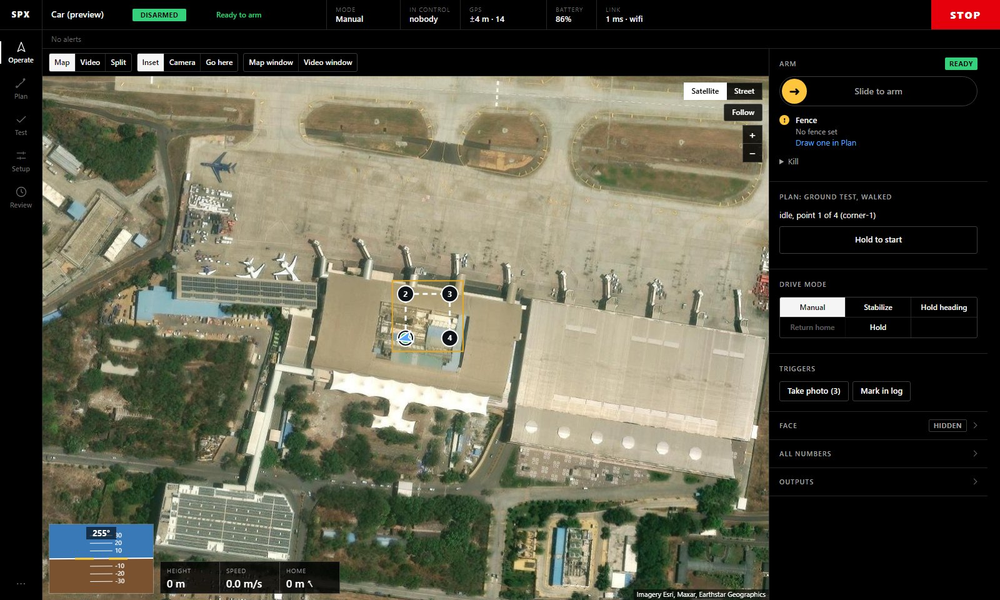
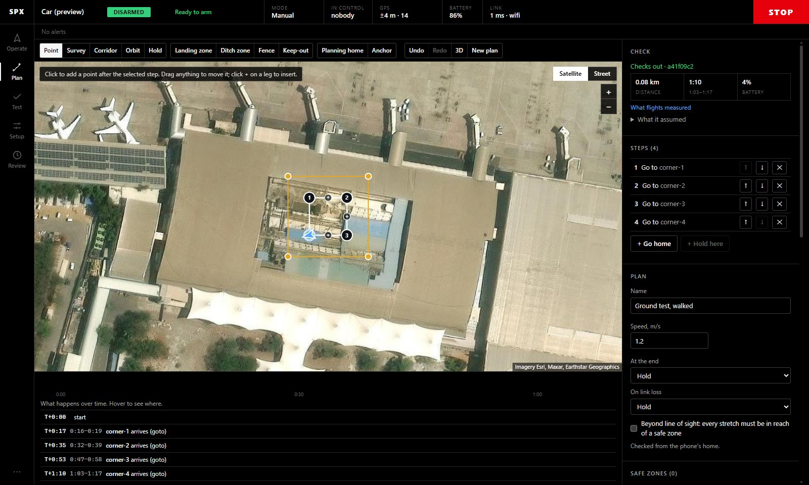
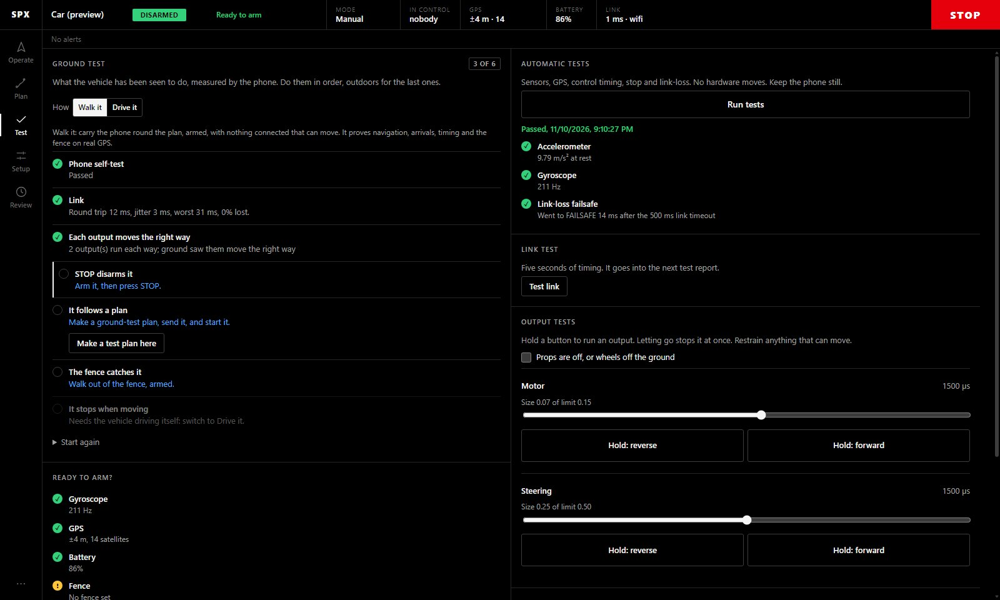
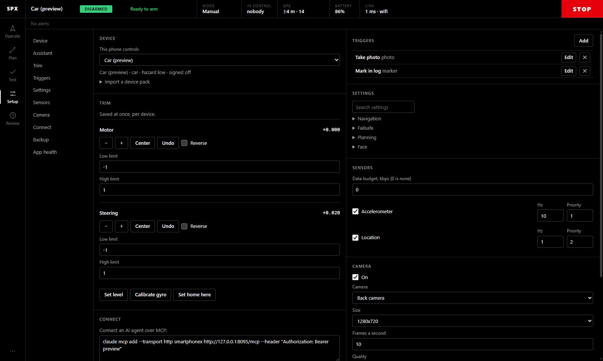

# Ground station guide

The ground station is a web app that the phone serves itself. It works in any modern browser on a laptop, tablet or
another phone, and the same screens run inside the phone app. This guide covers every screen. For first-time setup, see
[GETTING_STARTED.md](GETTING_STARTED.md).

**Contents:** [Layout](#the-layout) · [Operate](#operate) · [Plan](#plan) · [Test](#test) · [Setup](#setup) ·
[Review](#review) · [Several screens](#several-screens) · [Themes](#themes-and-sounds)

## The layout

The layout stays the same on every page, and nothing moves around as values change.

| Part | What it shows |
|---|---|
| **Status bar** (top) | The device name, armed or disarmed (with an armed timer), readiness or data age, then fixed fields: **Mode**, **In control**, **GPS** (accuracy and satellites), **Battery** and **Link** (round trip and network) |
| **STOP** (top right) | Always there, on every page and in every window. It disarms at once, and nothing outranks it |
| **Alert line** | One line under the status bar. The most important alert shows first, with **+N more** to see the rest and **OK to all** to acknowledge them |
| **Rail** (left) | The pages: Operate, Plan, Test, Setup and Review. The **…** menu at the bottom holds sounds and the sunlight theme. On a narrow screen the rail becomes a bottom bar |

Data that has stopped arriving is shown as stale, never as if it were current.

## Operate

Flying or driving happens here.

**The toolbar** above the view:

| Group | Buttons |
|---|---|
| Layout | **Map**, **Video**, or **Split**, which shows both side by side |
| View options | **Inset**: a small picture of the other view in the corner. **Swap** in the inset makes it the main view. **Camera**: turns the phone's camera stream on or off. **Go here**: then tap the map to send the vehicle there |
| Other screens | **Map window** and **Video window** open a view in its own window, for a second monitor |

The layout and inset you choose are remembered in this browser.

**On the map:**

- **Satellite** or **Street** imagery, and **Follow** to keep the vehicle centred.
- **Zoom** with the mouse wheel (half a level per notch, eased), a trackpad, a two-finger pinch, or the **+ / −** buttons.
  The point under the pointer stays put.
- **Drag** to pan. A press that moves less than a few pixels counts as a tap, so tapping a point never nudges the map.
- The plan, the fence, home and the vehicle's track are drawn over the imagery.

**Over the main view:** height, speed and distance to home, and an artificial horizon with the heading.

**The control panel** (right):

| Section | What it's for |
|---|---|
| **Arm** | **Slide to arm**, once every check passes. Anything that blocks arming is listed with how to fix it. **Kill** is folded away under it |
| **Plan** | The plan on the phone, where it's up to, and **Hold to start** |
| **Drive mode** | Manual, Stabilize, Hold heading, Return home, Hold. The names follow the vehicle type, so a plane shows flight modes |
| **Triggers** | Buttons for actions you set up, such as *Take photo* or *Mark in log* |
| **Face**, **All numbers**, **Outputs** | The robot face on the phone's screen, every live value, and each output's live value |

When armed and you're the operator, on-screen sticks appear over the view. A gamepad connected to the computer works as well.

## Plan

Draw a mission on the map, and the phone checks it as you go.

| Tools | What they add |
|---|---|
| **Point**, **Survey**, **Corridor**, **Orbit**, **Hold** | Steps: single points, a lawnmower pattern over an area, a path along a line, circles round a point, and waits |
| **Landing zone**, **Ditch zone**, **Fence**, **Keep-out** | Areas: where it may land, where to go if things go wrong, the outer boundary, and places to avoid |
| **Planning home**, **Anchor** | Where the plan is checked from, and a fixed reference point |
| **Undo**, **Redo**, **3D**, **New plan** | Editing, a 3D view of the route over terrain, and starting fresh |

Click to add a point after the selected step. Drag anything to move it, or click **+** on a leg to insert a point.

The right-hand panel shows:

- **Check:** the phone's verdict, with distance, time and battery. **What it assumed** says how it worked them out, and
  **What flights measured** says how earlier runs compared.
- **Steps:** reorder or delete them, and add **Go home** or **Hold here** at the end.
- **Plan:** the name, speed, what to do at the end, what to do on link loss, and the beyond-line-of-sight rule.

Under the map, a timeline shows what happens when. Hover over a row to see where it happens.

Plans can be imported from and exported to QGroundControl. The plan format and the compiler's checks are in [PLANNING.md](PLANNING.md).

## Test

| Section | What it does |
|---|---|
| **Ground test** | A checklist the phone grades from what it has measured: self-test, link, outputs, STOP, following a plan, the fence and stopping. Choose **Walk it** or **Drive it**. See [GETTING_STARTED.md](GETTING_STARTED.md#7-the-ground-test) |
| **Ready to arm?** | Every arming check, with its value and how to fix it |
| **Automatic tests** | **Run tests**: sensors, GPS, control timing, STOP and the link-loss failsafe. No hardware moves |
| **Link test** | Five seconds of round-trip timing, added to the next test report |
| **Output tests** | Each output moves only while you hold **Hold: forward** or **Hold: reverse**, within a size limit you set. Tick *Props are off, or wheels off the ground* first |

## Setup

An index on the left jumps between sections:

| Section | What's there |
|---|---|
| **Device** | What this phone controls, and importing a device pack |
| **Assistant** | The LLM setup assistant, with your own key or a local model |
| **Trim** | Centre, reverse and limits for each output, saved per device. **Set level**, **Calibrate gyro** and **Set home here** |
| **Triggers** | Actions you can fire from Operate or from a plan |
| **Settings** | Every parameter, grouped and searchable |
| **Sensors** | Which sensors stream, how often and at what priority, within a data budget |
| **Camera** | Which camera, size, frame rate and quality, and whether an AI may read the camera and location |
| **Connect** | The MCP command for AI agents, and the relay's QR code |
| **Backup** | Download and restore the phone's data. The access token, AI key and relay link are never included |
| **App health** | The phone report to share in [PHONES.md](PHONES.md) |

## Review

Earlier runs with their logs and pictures, exports (telemetry, commands, events, sensors and flight), photos, and test reports.

## Several screens

You can watch from several places at once.

- **Split** puts the map and video side by side in one window.
- **Map window** and **Video window** open one view, full size, in its own window, so you can drag it to a second monitor.
  Pop-out windows **only watch**: they never send stick input, so they can't conflict with the window that is driving.
  They still have the status bar and **STOP**.
- More browsers or devices can pair at once. The status bar's **In control** shows who has control. Over the
  [relay](../deploy/README.md), **viewer** accounts can watch but not command.

## Themes and sounds

The default theme is pure black with high contrast, for screens indoors and at night. In bright sun, tick **Sunlight colours**
in the **…** menu for a light, high-contrast theme. The same menu has **Sounds for alerts**, and a link to the classic
screen for phones that run an older app.
